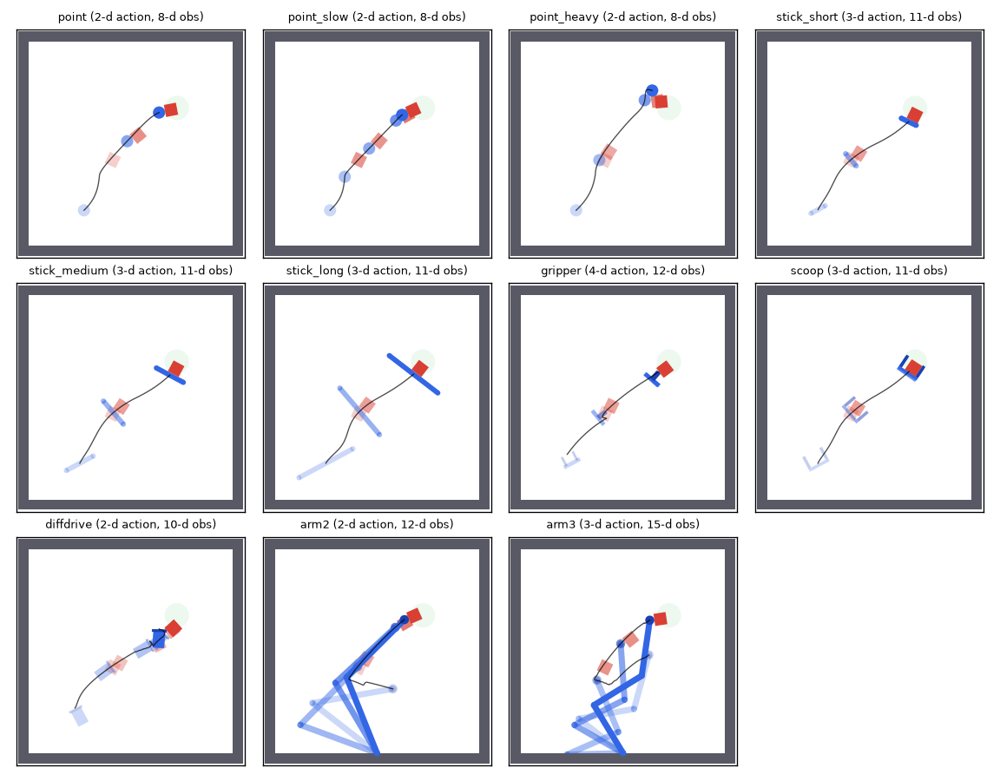
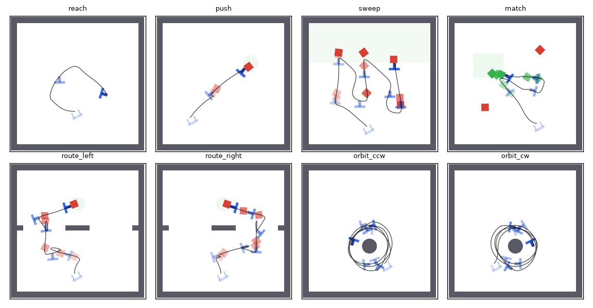

# xmagix

**A fast 2D cross-embodiment imitation benchmark on MuJoCo Warp.** It is a successor to
[x-magical](https://github.com/kevinzakka/x-magical) (Zakka et al., 2021): the same idea (one
tabletop world, many bodies, embodiment-independent task success), rebuilt for batched GPU
simulation and offline imitation, with more bodies, tasks, physics variants and datasets.



| | x-magical | xmagix |
|---|---|---|
| simulator | PyMunk, CPU, one env per process | MuJoCo Warp, thousands of worlds per GPU |
| interface | Gym | pure JAX functions (`jit`/`lax.scan`-able, via `warp.jax_callable`) + Gymnasium vector env |
| embodiments | 4 (gripper, 3 sticks) | 11: point (normal / slow / heavy), 3 sticks, gripper, scoop, diff-drive cart, 2- and 3-link arms |
| action spaces | body-frame velocity | world-frame force, body-frame force, non-holonomic thrust+turn, joint torques |
| tasks | 6 manipulation | 8: reach, push, sweep, match regions, route (left/right gap), orbit (ccw/cw) |
| path-dependent tasks | – | route and orbit: same start and goal, different required path or direction |
| physics variants | – | default, heavy blocks, slippery floor |
| offline data | demonstrations | reward-free play datasets (OGBench format) + observation-only demonstrations |
| validity check | – | every task × body pair has a measured scripted-expert success rate |

## Install

```bash
uv sync --extra gpu        # jax[cuda12], mujoco-warp, warp-lang
uv run pytest -q           # 37 tests (GPU)
```

## Use

```python
import jax, xmagix

env = xmagix.make("push", "gripper", num_envs=4096)        # task, embodiment
state = env.reset(jax.random.PRNGKey(0))
state, obs, info = env.step(state, actions, key)           # info: success, score, done

# a whole evaluation is one compiled program
final, traj = xmagix.rollout(env, lambda obs, s, k: my_policy(obs), key, steps=env.horizon)

# Gymnasium view (numpy in/out, auto-reset, reward = success)
from xmagix.vector import make_vec
venv = make_vec("orbit_ccw", "arm3", num_envs=256)
```

Everything is batched over worlds. `env.expert(state)` is the scripted expert, and
`xmagix.valid_pairs()` lists the task × embodiment pairs whose expert succeeds at least 90% of
the time: the pairs the benchmark uses.

## Embodiments

All bodies move in one horizontal plane (x, y, heading). The floor's friction is joint damping.
Observations are the body's proprioception plus every block in the body's own frame. Their
dimension and meaning differ per body, so raw-state matching has no shortcut.

| name | body | action | what is different |
|---|---|---|---|
| `point` | disc | world-frame force (2) | reference |
| `point_slow` | disc, 0.4× force | (2) | speed only: tests time-scale estimation; 2.5× horizon |
| `point_heavy` | disc, 4× mass | (2) | momentum; 1.5× horizon |
| `stick_short/medium/long` | rod 0.16 / 0.30 / 0.60 | body-frame force + torque (3) | reach and sweep width (x-magical's sticks) |
| `gripper` | palm + 2 sliding fingers | body-frame force, torque, close (4) | can cradle a block (x-magical's gripper) |
| `scoop` | U-shaped plough | body-frame force + torque (3) | carries what it pushes |
| `diffdrive` | cart, sideways friction | thrust + turn (2) | non-holonomic: cannot move sideways |
| `arm2`, `arm3` | fixed-base planar arms | joint torques (2 / 3) | joint space, limited workspace, links touch blocks |

## Tasks



| task | success (object state or effector path only) | probes |
|---|---|---|
| `reach` | visit 3 waypoints in order | alignment without objects |
| `push` | block inside the goal disc | transport, goal precision |
| `sweep` | all 3 blocks above the line (x-magical's SweepToTop) | multiple objects |
| `match` | both green blocks in the region, no red ones (x-magical's MatchRegions) | object selection |
| `route_left` / `route_right` | block at the goal **through the demonstrated gap** | the path, not just the goal |
| `orbit_ccw` / `orbit_cw` | a full lap around the pillar in the demonstrated direction | direction: invisible to state-occupancy matching |

Success never depends on the body, so a demonstration by one body is a valid task
specification for every other one. Physics variants: `make(..., variant="heavy" | "slippery")`.

## Validity: scripted-expert success

Measured with 256 episodes per pair (`scripts/expert_check.py`, stored in
`xmagix/expert_success_<variant>.json`). Pairs below 0.9 are not used. That is the honest
outcome of physical differences: a 0.6-long stick does not fit through a 0.7 gap while pushing,
and a fixed-base arm cannot reach the far corners.

**default** physics: 71 of 88 pairs valid.

| task | `point` | `point_slow` | `point_heavy` | `stick_short` | `stick_medium` | `stick_long` | `gripper` | `scoop` | `diffdrive` | `arm2` | `arm3` |
|---|---|---|---|---|---|---|---|---|---|---|---|
| reach | 1.00 | 1.00 | 1.00 | 1.00 | 1.00 | 1.00 | 1.00 | 1.00 | 1.00 | 1.00 | 1.00 |
| push | 1.00 | 1.00 | 1.00 | 1.00 | 1.00 | 1.00 | 1.00 | 1.00 | 0.96 | 1.00 | *0.88* |
| sweep | 1.00 | 1.00 | 1.00 | 1.00 | 1.00 | *0.78* | 1.00 | *0.10* | *0.71* | 0.96 | *0.23* |
| match | 1.00 | 1.00 | 1.00 | 1.00 | 1.00 | 0.95 | 1.00 | *0.00* | 0.96 | *0.15* | 0.92 |
| route_left | 1.00 | 1.00 | 1.00 | 1.00 | 1.00 | *0.16* | 1.00 | *0.20* | *0.28* | *0.06* | *0.65* |
| route_right | 1.00 | 1.00 | 0.99 | 1.00 | 1.00 | *0.17* | 1.00 | *0.19* | *0.33* | *0.04* | *0.00* |
| orbit_ccw | 1.00 | 1.00 | 1.00 | 1.00 | 1.00 | 1.00 | 1.00 | 1.00 | 1.00 | 1.00 | 1.00 |
| orbit_cw | 1.00 | 1.00 | 1.00 | 1.00 | 1.00 | 1.00 | 1.00 | 1.00 | 1.00 | 1.00 | 1.00 |

*Italic* = below 0.9, excluded.

**heavy** physics: 67 of 88 pairs valid.

**slippery** physics: 55 of 88 pairs valid.


## Data

```bash
uv run python scripts/generate.py --valid_only              # all valid pairs
uv run python scripts/generate.py --tasks push --embodiments point gripper
```

Each pair gets `data/<task>-<body>/play.npz` and `demos.npz`.
- **play.npz:** 1M reward-free transitions. The scripted planner chases random sub-goals (a random block to a random place, or the effector to a random point), re-sampled every 25–100 steps, with Gaussian action noise and 10% random actions. It solves the evaluation task by chance about 1.5% of the time.
- **demos.npz:** 5 observation-only expert demonstrations. Goal tasks are terminated just after success; orbit demonstrations run the full horizon and are flagged `truncated`.

Keys follow OGBench (`observations, actions, terminals, qpos, qvel`), so OGBench loaders read
them. Generating 1M transitions takes 30–45 s per pair on one RTX 4090.

## Speed

Environment steps per second (1 step = 5 physics steps), scripted expert in the loop, one RTX 4090 **shared with other training jobs** (a lower bound). Measured by `benchmarks/speed.py`.

| embodiment (push) | CPU MuJoCo, 1 thread | 1,024 worlds | 4,096 worlds | 16,384 worlds |
|---|---|---|---|---|
| `point` | 30,747 | 85,110 | 273,807 | 840,483 |
| `stick_medium` | 12,528 | 187,825 | 592,373 | 1,243,904 |
| `gripper` | 8,038 | 118,181 | 359,496 | 701,811 |
| `arm3` | 28,107 | 65,078 | 199,781 | 415,133 |

## Notes

- **Physics.** Timestep 0.01 s, 5 substeps per control step (20 Hz control), implicit-fast
  integrator, no gravity. Fixed-base arms reach over walls (collision groups).
- **Reproducibility.** The same key gives the same trajectory up to floating-point atomics in
  MJWarp's contact solver: differences are ≤ 2·10⁻³ after 50 contact-rich steps, not
  bit-exact. CPU MuJoCo (`backend="cpu"`) is the reference; tests check that the two agree.
- **Pixels** are planned through MJWarp's batched renderer; the API does not need to change.
